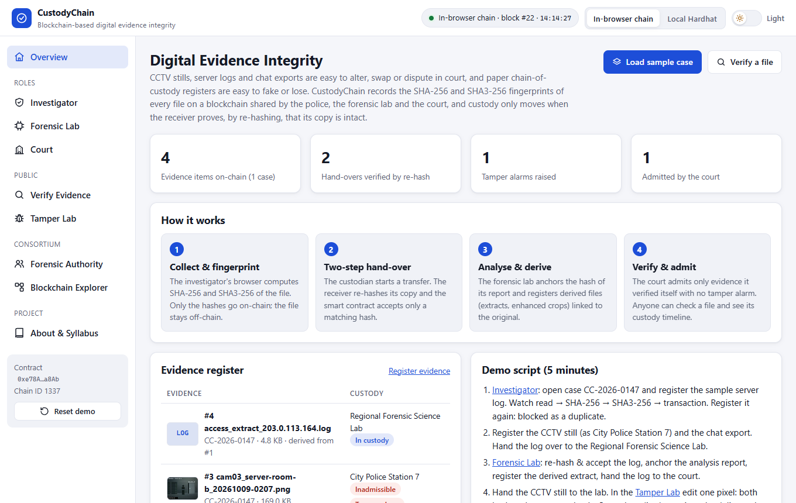
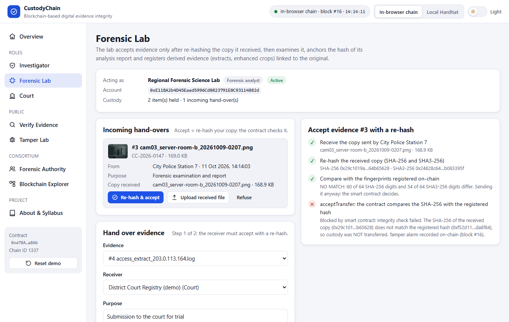
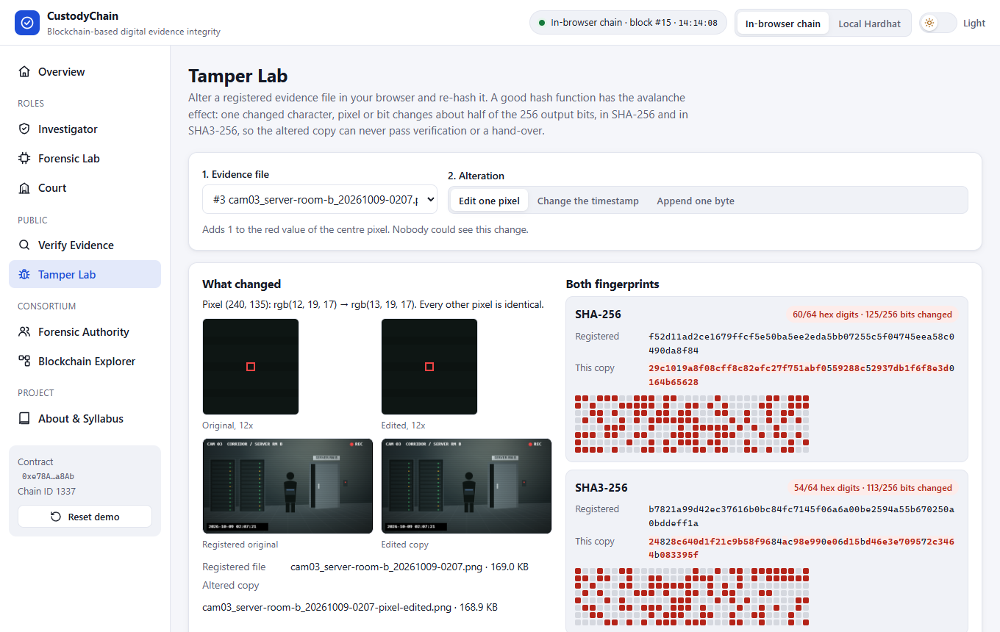
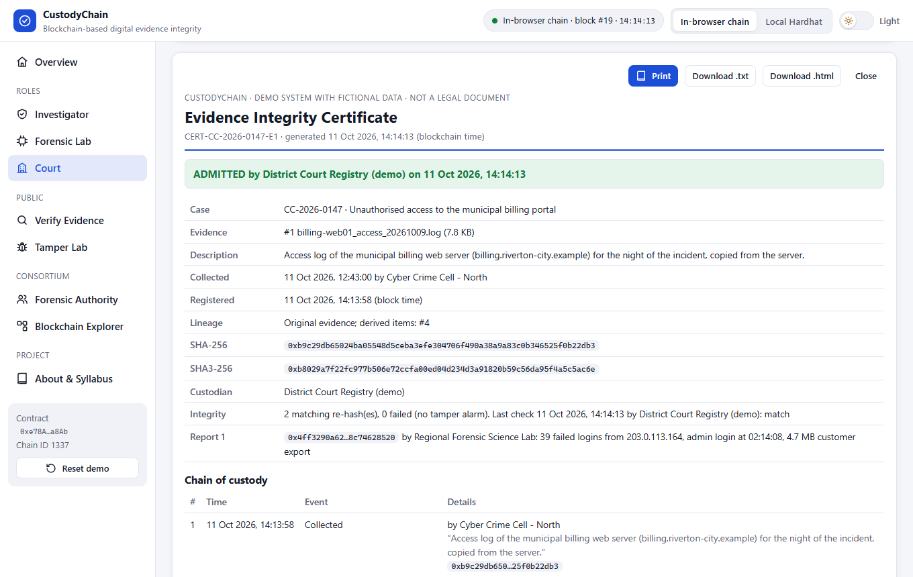
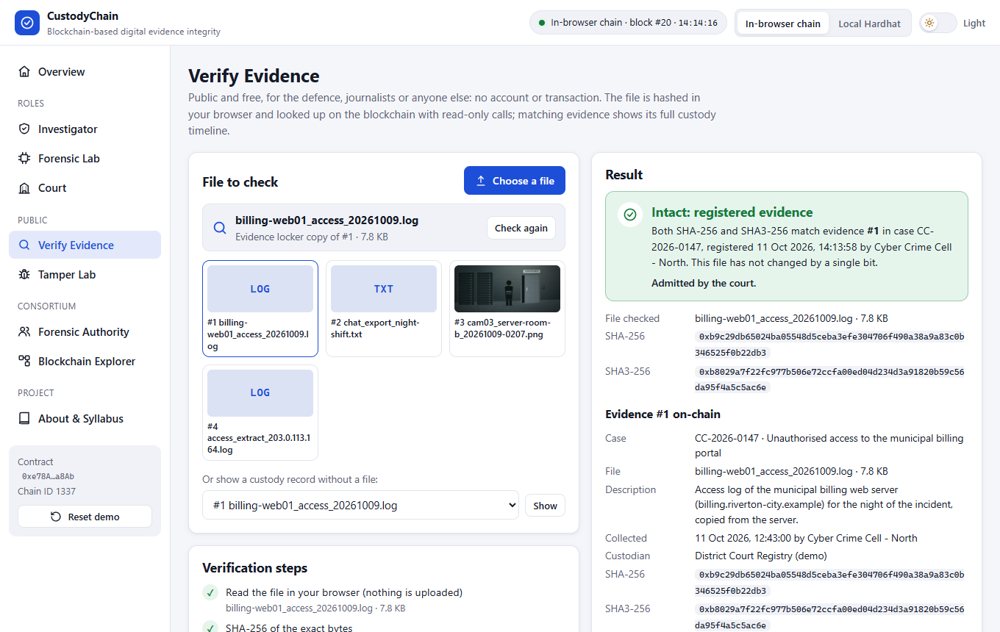
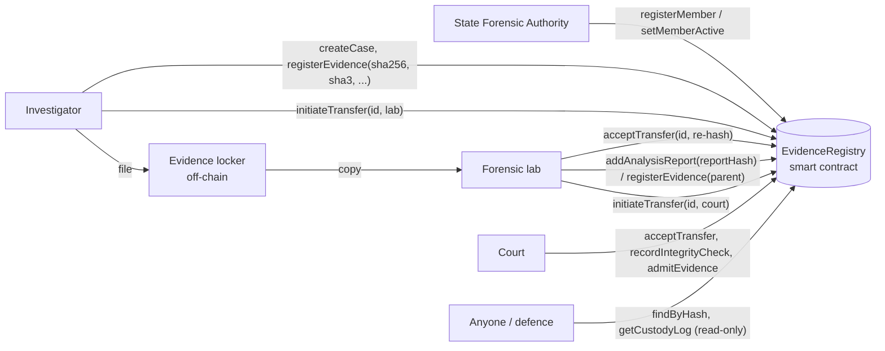

# CustodyChain: Blockchain-Based Digital Evidence Integrity System

Police, the forensic lab and the court share one blockchain register of digital evidence. Every file is fingerprinted with **SHA-256 and SHA3-256**, every hand-over is accepted **only after the receiver re-hashes its copy**, and a failed check stays on record as a **tamper alarm** that blocks admission in court.

**Live demo:** https://syedareeb06.github.io/digital-evidence-integrity/ (runs entirely in your browser: no wallet, no install, no real cryptocurrency)



---

## The problem

Digital evidence (CCTV stills, server logs, chat exports, disk images) is just bytes. Today:

- a file can be edited or swapped for another copy while it moves between the police station, the lab and the court,
- the defence can dispute it ("is this really the file you seized?") and nobody can prove otherwise, and
- the paper chain-of-custody register that should answer that question is easy to back-date, fake or lose, and each agency keeps its own.

## The solution

| Step | What happens | Technique |
|---|---|---|
| 1. Collect & fingerprint | The investigator's browser computes the **SHA-256** and **SHA3-256** of the exact file. Only the two hashes, the file name, size, description and collection time go on-chain. The contract rejects duplicates and collection times in the future. | SHA-256 (FIPS 180-4), SHA3-256 (FIPS 202) |
| 2. Two-step hand-over | The custodian starts a transfer. The receiver re-hashes the copy it actually received and presents the hash; **custody moves only if it equals the registered hash**. A wrong hash reverts with `IntegrityMismatch`, and the failed check is then stored as a permanent tamper alarm. | Solidity smart contract |
| 3. Analyse & derive | The forensic lab anchors the hash of its analysis report and registers derived evidence (a log extract, an enhanced crop) linked to its parent. | Hash commitments, evidence lineage |
| 4. Verify & admit | The court admits evidence only if it holds it, no tamper alarm was ever raised and its own latest re-hash matched; it prints an **Evidence Integrity Certificate**. Anyone can verify a file and see the full custody timeline. | Read-only contract calls, permissioned consortium |

## Features

- **Investigator**: open cases, register built-in sample evidence or your own file (max 10 MB) with live steps (read → SHA-256 → SHA3-256 → transaction → off-chain copy), start and cancel hand-overs; the contract refuses duplicates, duplicate case numbers and future collection times
- **Forensic Lab**: accept incoming evidence with a re-hash (or upload the file you received), examine it and anchor the analysis report, register derived evidence, re-verify, hand over to the court
- **Court**: accept with a re-hash, re-verify, admit or rule inadmissible, tamper-alarm list, printable **Evidence Integrity Certificate** (print, `.txt` and `.html` download)
- **Verify Evidence** (public, no account): drop any file → intact / no match / analysis report, with the record and custody timeline; or look up a record by id
- **Tamper Lab**: change one character, delete one line, edit one pixel, change a CCTV timestamp, flip one bit or append one byte; see both hashes change (differing hex digits highlighted, 256-bit grids of flipped bits) and swap the altered copy into a pending delivery to watch the acceptance fail
- **State Forensic Authority**: admit police units, labs and courts with a role; suspend or re-activate them
- **Blockchain Explorer**: hash-linked blocks, decoded transactions and an audit log in plain sentences
- Built-in sample evidence generated in the browser (synthetic web-server log of an intrusion, CCTV still drawn on a canvas, chat export); all names, IP addresses (RFC 5737 ranges) and domains (`.example`) are fictional
- Light / dark theme switch in the top bar (follows the system theme until you choose)
- Two blockchains: an **in-browser Ethereum chain** (zero setup) or a **local Hardhat node**

| Forensic lab: tampered copy refused | Tamper Lab: one pixel, two broken hashes |
|---|---|
|  |  |

| Court: Evidence Integrity Certificate | Verify Evidence: intact, with custody timeline |
|---|---|
|  |  |

## Syllabus mapping (22CS743, Blockchain Technology)

| Module | Concepts | Where they appear in this project |
|---|---|---|
| **II** | Hash functions: SHA-256 and SHA-3 (Keccak family, FIPS 202), avalanche effect, hash-linked blocks | Every file is hashed with both functions in the browser; the Tamper Lab shows that one changed pixel or byte flips about half of the 256 output bits of both; the explorer checks each block's previous-hash link |
| **III** | Ethereum, EVM, smart contracts, accounts and signed transactions | `EvidenceRegistry.sol` enforces the custody rules (two-step transfer with hash check, tamper alarms, admission conditions) with custom errors and events; every action is a transaction signed by the member's account |
| **IV** | Permissioned / consortium blockchain | The State Forensic Authority admits police units, forensic labs and courts with roles and can suspend them; only members act, anyone can read |
| **V** | Applications: digital forensics, access control, security, privacy | Tamper-evident audit trail and integrity certificate for legal admissibility, role-based access control, files kept off-chain (only hashes are public) |

## Architecture



Custody rules enforced by the contract:

- original evidence is registered by an investigator, who becomes the first custodian; derived evidence by the investigator or analyst who holds the parent, in the same case;
- a file can be registered once (looked up by either hash), and never with a collection time later than the block time;
- only the custodian can start a hand-over, one at a time, to an active member; only the named receiver can accept it, and only with the registered SHA-256;
- any active member can record an integrity check; a mismatch sets a permanent tamper alarm;
- a court admits only evidence it holds, without a pending hand-over or tamper alarm, whose latest check is the court's own matching re-hash. After a ruling (admitted or inadmissible) the record is closed.

**On-chain:** members and roles, cases, both hashes of each file, file name, size, description, collection time, current custodian and the append-only custody log (every hand-over, integrity check, report hash and court decision).
**Off-chain:** the evidence files and reports. The demo keeps files up to 512 KB in browser storage as the "evidence locker" (images also get a thumbnail); larger files are only hashed and receivers upload their own copy.

## Tech stack

- **Smart contract:** Solidity 0.8.24, Hardhat (local blockchain, tests, deployment)
- **Frontend:** HTML, CSS, JavaScript (no build step), ethers.js v6, Web Crypto API (SHA-256), js-sha3 (SHA3-256), Canvas API
- **Demo blockchain:** Ganache running inside the browser (same EVM, same contract)
- **Hosting:** GitHub Pages

## Project structure

```
digital-evidence-integrity/
├── blockchain/                       # Smart contract project (Hardhat)
│   ├── contracts/EvidenceRegistry.sol
│   ├── test/EvidenceRegistry.test.js # 24 unit tests, every custom error covered
│   ├── scripts/deploy.js             # deploy + register demo consortium on localhost
│   ├── scripts/export-artifact.js    # copy ABI + bytecode into the web app
│   └── hardhat.config.js
├── frontend/                         # Web app (open index.html)
│   ├── index.html
│   ├── css/
│   ├── js/app.js                     # CustodyChain screens and logic
│   ├── js/custody-crypto.js          # SHA-256, SHA3-256, digit/bit comparison
│   ├── js/evidence-samples.js        # sample evidence, lab extracts, Tamper Lab edits
│   ├── js/chain.js                   # in-browser chain / local Hardhat connection
│   ├── js/contract-artifact.js       # compiled contract (generated)
│   └── vendor/                       # ethers.js, Ganache, js-sha3 (browser builds)
├── docs/screenshots/
└── index.html                        # redirects GitHub Pages to frontend/
```

## How to run

### Option 1: Zero install (recommended for demos)

Open the [live demo](https://syedareeb06.github.io/digital-evidence-integrity/), **or** double-click `frontend/index.html`.
An Ethereum blockchain starts inside the page. Your data is saved in the browser; click **Reset demo** in the sidebar to start over.

### Option 2: Local Hardhat blockchain

Requires [Node.js](https://nodejs.org/) 18 or newer.

```bash
cd blockchain
npm install
npm run node
```

Keep that terminal open. In a second terminal:

```bash
cd blockchain
npm run deploy
```

Then open `frontend/index.html` and click **Local Hardhat** in the top bar. (If you skip `npm run deploy`, the app deploys the contract itself.)

### Run the smart contract tests

```bash
cd blockchain
npm test
```

### After changing the contract

```bash
cd blockchain
npm run export
```

This recompiles and copies the new ABI and bytecode into `frontend/js/contract-artifact.js`.

## 5-minute demo script

1. **Investigator** (Cyber Crime Cell - North) → *Open case on-chain* (CC-2026-0147) → *Hash & register on the blockchain* with the sample server log. Watch read → SHA-256 → SHA3-256 → transaction → off-chain copy. Register it again: **"already registered as evidence #1"**.
2. Register the chat export, switch to **City Police Station 7** and register the CCTV still. Hand the CCTV still and the log over to the Regional Forensic Science Lab.
3. **Forensic Lab** → *Re-hash & accept* the log (custody moves), *Examine & anchor report*, *Register derived extract*, then hand the log to the court.
4. **Tamper Lab** → pick the CCTV still → *Edit one pixel*: about half of the 256 bits of both hashes flip. *Swap into the delivery* → on the lab page *Re-hash & accept*: **"integrity check failed ... custody was NOT transferred"**, and a tamper alarm is recorded on-chain.
5. **Court** → *Re-hash & accept* the log → *Admit* → the Evidence Integrity Certificate appears (print or download). Rule the CCTV still inadmissible from the *Tamper alarms* card.
6. **Verify Evidence** → pick or upload the log: **Intact**, with the full custody timeline. Try a Tamper Lab copy: **No match**.
7. **Blockchain Explorer**: hash-linked blocks and the audit log. **Forensic Authority**: suspend a member and watch its next action fail.

Short on time? **Load sample case** on the Overview registers the three sample files at once.

## Publishing on GitHub Pages

1. Push this folder to a GitHub repository named `digital-evidence-integrity`.
2. On GitHub: **Settings → Pages → Build and deployment → Source: Deploy from a branch → Branch: `main`, folder: `/ (root)` → Save**.
3. After about a minute the site is live at `https://syedareeb06.github.io/digital-evidence-integrity/`.

## Limitations and future work

- A hash proves that a file has not changed since it was registered, not that it was genuine when collected: a staged photo hashes just as well. Collection procedures (and, in practice, write blockers and signed acquisition tools) still matter.
- File names and descriptions are public on-chain. A real system would encrypt sensitive metadata or store only its hash, to protect victims and suspects.
- In the demo all members share one browser and one evidence locker; the "received copy" is the locker copy unless you upload your own file. Real agencies would exchange files over their own channels and keep keys in hardware wallets.
- A production deployment would run on a permissioned network operated by the consortium (for example Hyperledger Besu) instead of a public chain.

## License

MIT, see [LICENSE](LICENSE).
